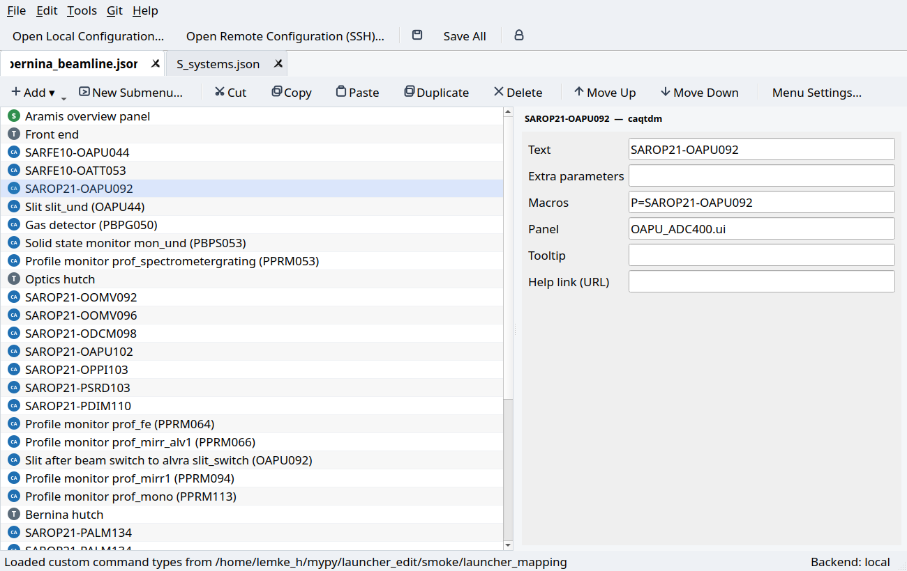
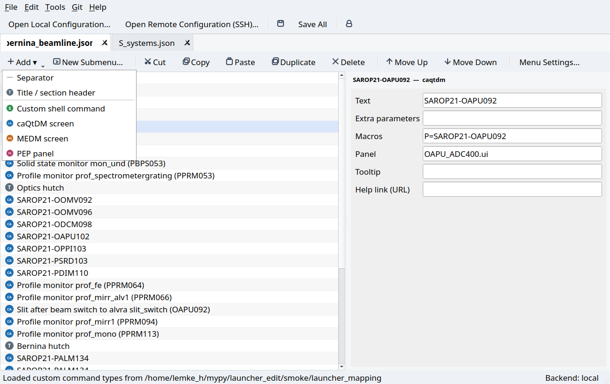
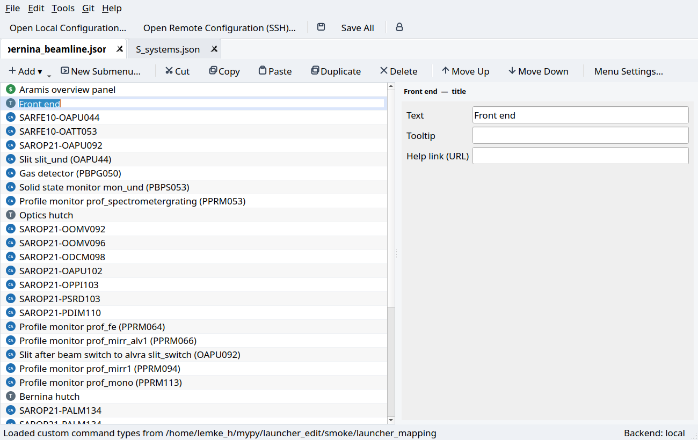
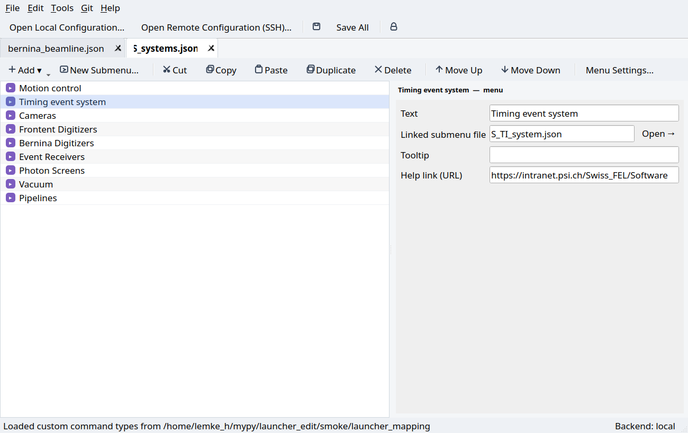
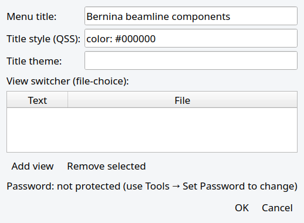
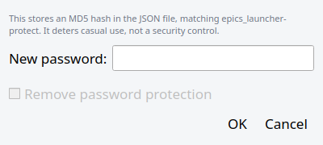

# Launcher Config Editor

A GUI editor for [`epics_launcher`](https://gitea.psi.ch/augustin_s/epics_launcher)
menu configuration files — the JSON files behind the PSI beamline "Launcher"
button panels (e.g. `/sf/bernina/config/launcher`).

It reads and writes the *exact same* JSON format as the original launcher, so
anything you edit here shows up unchanged the next time someone opens (or
reloads) the menu in `epics_launcher` itself. There is no new file format,
no database, no server — just a friendlier way to edit the same files.



## Why

Hand-editing these JSON files works, but it's easy to break a comma, lose
track of which file a submenu points to, or dread reordering ten entries by
cutting and pasting lines. This tool gives you:

- **Template-based entry creation** — pick "caQtDM screen", "MEDM screen",
  "Custom shell command", etc. from a menu instead of remembering field names.
- **Copy / paste between different menu files** — select entries in one
  menu, switch to another open tab, paste.
- **Drag and drop reordering** within a menu.
- **Inline rename** — double-click an entry's label to rename it in place,
  no dialog required.
- **One-click submenu management** — "New Submenu…" creates and links a new
  JSON file for you; deleting a submenu link can also delete the file, and
  warns you first if other menus still reference it.
- **Custom command types** — define your own reusable command templates
  (added to the site's `launcher_mapping` file), on top of the usual
  `cmd` free-form shell command.
- Works directly against files on a **remote server over SSH/SFTP** (e.g.
  `saresb-cons-05`), so you don't need an NFS mount of `/sf` on your laptop.

## Installation

Requires Python 3.8+ and PyQt5 (the same GUI toolkit `epics_launcher` itself
uses). The tool is not on PyPI; pip installs it straight from this repository.

### Quick install (any machine with Python)

```bash
pip install "git+https://github.com/swissfel/launcher_editor"
```

pip pulls in PyQt5 if it's missing. Add the `remote` extra if you want to
open files over SSH (see [Viewing a remote configuration over
SSH](#viewing-a-remote-configuration-over-ssh)):

```bash
pip install "launcher-editor[remote] @ git+https://github.com/swissfel/launcher_editor"
```

To update later, run the same command with `--upgrade`; to remove it,
`pip uninstall launcher-editor`.

### On the SwissFEL consoles

The shared Bernina Python environment already has PyQt5 and paramiko, so
only the editor itself gets installed, into your user site-packages, without
touching the shared environment:

```bash
/sf/bernina/applications/python/environments/bpy312/bin/python -m pip install --user \
    "git+https://github.com/swissfel/launcher_editor"
```

The consoles each have their own local `$HOME`, so repeat this on every
console you use.

### Running it

The install adds a `launcher-editor` command:

```bash
launcher-editor                      # opens with nothing loaded
launcher-editor path/to/menu.json    # opens a menu file directly
```

Options:

| Option | Meaning |
|---|---|
| `--read-only` | View only: saving, editing and publishing are disabled. Useful for looking at a deployed configuration. |
| `--preview-command CMD` | What **Preview** runs; the root menu file is appended. Default `epics_launcher`. Use the same options your consoles use, e.g. `"epics_launcher --position 80 -120"`. |
| `--publish-note TEXT` | Extra text shown in the Publish dialog and after publishing, e.g. how long the deploy takes. |
| `--git URL` | Clone (first time) or update this repository and open it; the positional file is then relative to the repository, e.g. `launcher-editor --git git@host:group/repo.git S_Main.json`. |
| `--branch NAME` | Branch for `--git` (default: the repository's default branch). |
| `--checkout DIR` | Local folder for the `--git` clone (default `~/launcher-editor/<repository name>`). |

If `launcher-editor` isn't found (`~/.local/bin` not on your `PATH`), use
`python -m launcher_editor` with the same Python you installed it into.

### Development install

```bash
git clone https://github.com/swissfel/launcher_editor
cd launcher_editor
pip install -e ".[dev]"
```

## Getting started: change your beamline's launcher

The launcher configuration on the consoles (e.g. `/sf/bernina/config/launcher`)
is **read-only and auto-deployed** from a git repository: every push to that
repository's `master` updates the launcher on all consoles. Edits made
directly in `/sf/.../config/launcher` can't be saved and would be overwritten
by the next deploy anyway. So the workflow is: clone, edit, commit, push.

1. **Clone the configuration repository** (Bernina shown; other beamlines
   have their own `autodeploy_config/sf_<beamline>_launcher` repository):

   ```bash
   git clone git@gitea.psi.ch:autodeploy_config/sf_bernina_launcher.git
   cd sf_bernina_launcher
   ```

2. **Open the main menu.** `S_Bernina.json` is the menu the consoles open
   (`epics_launcher_wrapper` loads `S_<Beamline>.json`):

   ```bash
   launcher-editor S_Bernina.json
   ```

   The editor finds the `launcher_mapping` file in the same folder, so the
   **Add** menu offers the beamline's real entry types (`caqtdm`, `medm`,
   `pep`, …). Double-click a submenu entry to open its file in a new tab.

3. **Make a change** (e.g. rename an entry with F2, or **Add ▾** a new
   one) and save with **Ctrl+S** (**Ctrl+Shift+S** saves all tabs).

4. **Try it: Preview (F5).** This opens your copy in the real
   `epics_launcher`, exactly as the consoles would show it. While the
   preview is open, it restarts by itself every time you save, so you see
   each change right away. Nothing is deployed yet.

5. **Make it live: Publish… (Ctrl+Shift+P).** The dialog lists the
   changed files and the full diff. Type a few words about what you
   changed and press **Publish**. The editor then:
   - commits your changes, without the `.bak` backups the editor writes on
     each save (they're added to the clone's local `.git/info/exclude`),
   - fetches what others pushed in the meantime and puts your commit on
     top (rebase, no merge commits),
   - pushes, which deploys it to every console.

   If someone else changed the same lines, nothing is published: the
   rebase is undone, your change stays as a local commit, and the message
   tells you how to sort it out with git. **Git → Update from Remote**
   brings your copy up to date (fast-forward only) without publishing.

   The first save of a compactly formatted file reformats it to indented
   JSON, so expect one large diff for that file.

To throw away local edits instead: `git checkout .` in the clone.

### Opening a git repository directly

**File → Open Git Configuration…** (Ctrl+Shift+G, first button on the toolbar) does the cloning for you:
enter the repository URL (and optionally a branch); the local folder is
filled in as `~/launcher-editor/<repository name>` and can be changed.
The first time, the repository is cloned there; each later time it is
updated (fast-forward only; if that isn't possible, e.g. because of
unpublished commits, your copy opens as it is). Then pick the root menu
file (files named `S_*.json` are suggested first). From there it's the
normal workflow: edit, **Preview**, **Publish…**.

SSH URLs (`git@host:group/repo.git`) use your SSH key. https URLs only
work with stored credentials, since the editor never asks for a password.

### Recent configurations

**File → Open Recent** lists the last configurations you opened, from all
sources: local files, SSH (host, user and path; never a password) and git
repositories (URL, branch, local folder and root file). Choosing an entry
reopens it directly: a git entry is updated and its root file opened
without any questions; an SSH entry first tries your SSH key and only
shows the connection dialog (prefilled) if that fails. The list keeps the
last 12 and is stored in the editor's settings (`~/.config/PSI/`).

### Viewing a remote configuration over SSH

**File → Open Remote Configuration (SSH)…** (needs the `remote` extra) opens
files directly on a host, with your normal SSH keys/agent. On the consoles
that's useful for *looking* at the deployed configuration, but saving there
fails (read-only), so make changes in a clone as described above. If SSH
needs a jump host or 2FA that `paramiko` can't handle, mount the folder with
`sshfs` and use **File → Open Local Configuration…** instead.

### Editing a local checkout

**File → Open Local Configuration…** and pick the root `.json` file. Useful
if you've mounted `/sf` locally, or want to try the tool on a scratch copy
first (recommended the first time!).

### Creating a brand-new configuration from scratch

**File → New Configuration…**, give it a title and file name. This is how
you'd start a whole new beamline/area menu tree.

## Everyday tasks

### Add a new entry

Click **Add ▾** in a menu's toolbar and pick a template. Built-in types
(*Separator*, *Title*, *Custom shell command*) are always available; the
rest come from the mapping file that's loaded for the current site
(`caQtDM screen`, `MEDM screen`, `PEP panel`, or any site-specific type).



The new entry is inserted right after the currently selected row (or at the
end if nothing is selected), and the editor immediately starts an inline
rename so you can type its label right away.

### Rename an entry

Double-click its label in the list (or select it and press **F2**) and
type the new text — no dialog, no touching JSON.



You can also rename (and edit every other field) from the **properties
panel** on the right, which shows exactly the fields relevant to that
entry's type.

### Reorder entries

Drag an entry up or down within its list to reorder it. `Move Up` /
`Move Down` toolbar buttons (or **Ctrl+↑ / Ctrl+↓**) do the same thing one
step at a time, handy for precise positioning.

### Copy or move entries between menus

1. Select one or more entries (click, Shift-click, Ctrl-click).
2. **Copy** (Ctrl+C) or **Cut** (Ctrl+X).
3. Switch to the destination tab (open it first via double-click on a
   submenu entry, or the linked file field's **Open →** button).
4. **Paste** (Ctrl+V) — entries are inserted after the current selection.

Copying also puts the entries on the system clipboard as readable JSON, so
you can paste into a text editor to inspect them, or paste JSON copied
elsewhere back into the app.

### Add a new submenu

Click **New Submenu…**, give it a title. The editor:

1. Creates a new, empty JSON file next to the current one (slugified from
   the title, e.g. "Vacuum System" → `vacuum_system.json`; you can rename
   the file before confirming).
2. Adds a `{"type": "menu", ...}` entry linking to it, right where your
   cursor was.
3. Offers to open the new submenu immediately so you can start filling it in.



### Delete a submenu

Select the submenu entry and press **Delete**. You'll be asked whether to
also delete the underlying JSON file. If any *other* menu file (in the same
folder) still links to it, the editor warns you before you delete the file
out from under them.

### Edit menu-level settings

**Menu Settings…** in a tab's toolbar edits the menu title/style, and the
"view switcher" (`file-choice`) list that lets a beamline offer e.g. an
"expert" vs. "user" view.



### Password-protect a menu

**Tools → Set/Clear Password…** stores an MD5 hash in the JSON file, the
same mechanism as the original `epics_launcher-protect` command-line tool.



### Define a new reusable custom command type

Most sites only need the built-in types (`cmd`, `caqtdm`, `medm`, `pep`).
If you need a new *kind* of button across many menus (say, launching an
in-house diagnostic tool with its own arguments), use **Tools → Add Custom
Command Type…**. This writes a new entry into the site's `launcher_mapping`
file — exactly the mechanism described in the
[epics_launcher mapping documentation](https://gitea.psi.ch/augustin_s/epics_launcher#mapping) —
and the new type immediately shows up in the **Add** gallery for every open
menu.

### Saving

**Ctrl+S** saves the current tab, **Ctrl+Shift+S** saves every open tab. A
`.bak` copy of the previous file content is written alongside it before
each save. Note: the first time you save a file that was hand-formatted
compactly (as most existing PSI configs are), the editor reformats it to
readable, indented JSON — this produces a larger one-time diff, but every
save after that is a normal, minimal diff.

### Preview

**File → Preview** (F5, or the toolbar button) starts the preview command
(default `epics_launcher`) on the root menu file of the configuration you
opened. As long as that window is open, every save restarts it, since
`epics_launcher` itself can't reload a menu. It only works for local files.

### Git

If the file you're editing is inside a git working copy, the **Git** menu
offers **Update from Remote** (`git pull --ff-only`), **Publish…** (see
[Getting started](#getting-started-change-your-beamlines-launcher)), and the
single steps **Status**, **Commit…** and **Push…**. Nothing happens
automatically; each is an explicit action. Git never prompts for a
password here: if your SSH key or credentials aren't available, the step
fails with git's message instead of hanging.

## How this relates to `epics_launcher`

This is a separate, independent tool — it does not modify or replace
`epics_launcher` itself. It just reads and writes the same configuration
format described in that project's README (`menu-title`, `file-choice`,
`menu`, `password`, item `type`s, and the per-OS `mapping` file for custom
types). Any change you make and save here is picked up the next time
`epics_launcher` loads or reloads that file — there's no conversion step.

If you want to verify this yourself: every file this editor writes is valid
input to `epics_launcher.launcher_model.launcher_menu_model`, the original
project's own parser.

## Development

```bash
pip install -e ".[dev]"
pytest
```

The core data model (`launcher_editor/model.py`, `backends.py`,
`workspace.py`) has no GUI dependency and is fully unit tested. The GUI
layer (`launcher_editor/gui/`) is PyQt5 and can be smoke-tested headlessly
with `QT_QPA_PLATFORM=offscreen`.

## License

GPL-3.0-or-later, matching the license of the upstream `epics_launcher`
project this tool is designed to work alongside.
